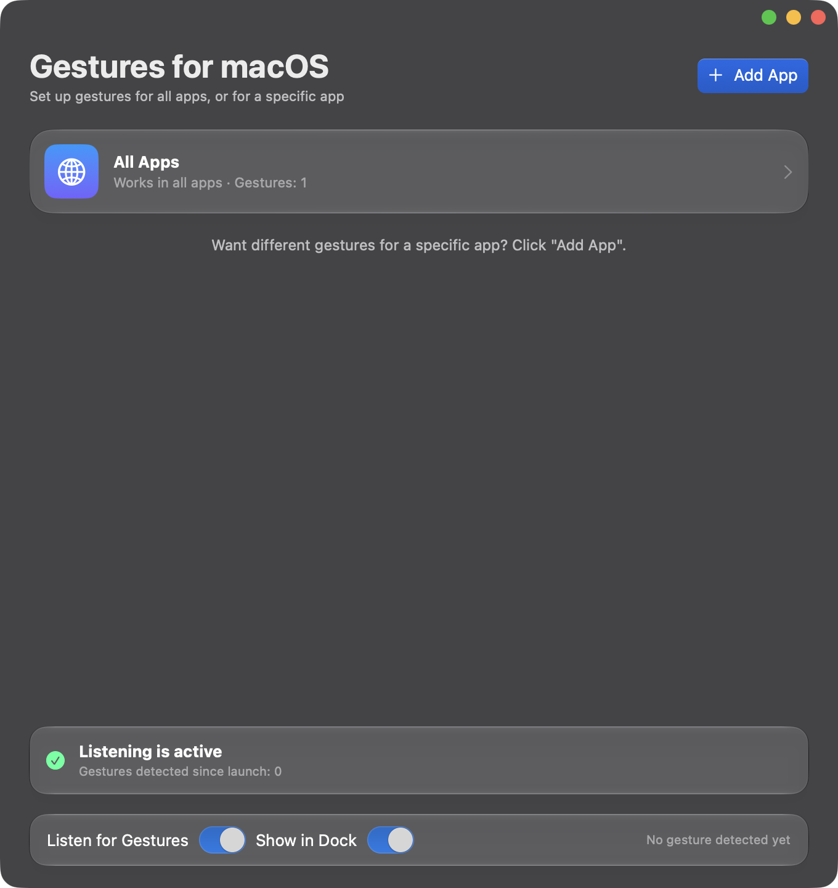
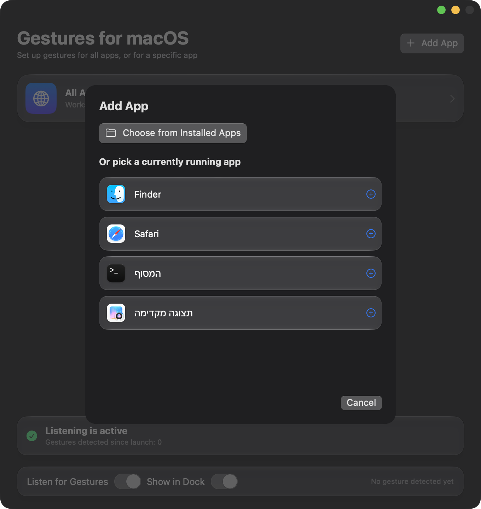
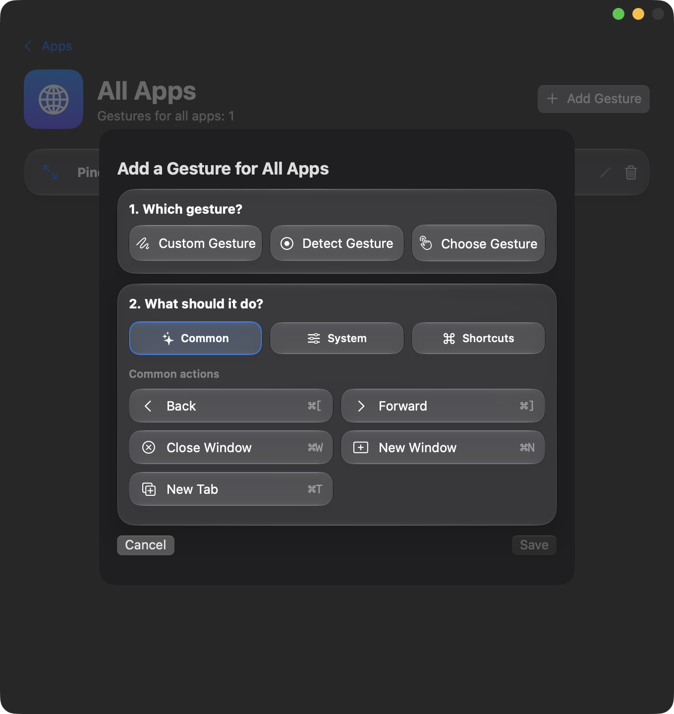

# Gestures for macOS

Run actions with trackpad gestures, and choose a different action for each app.

<a href="https://macnative.io/apps/gestures-for-macos?utm_source=macnative-badge&utm_medium=referral" target="_blank" rel="noopener"></a>

Gestures for macOS is a small native Mac app that lets you swipe, pinch, tap or hold on the trackpad to trigger actions. What happens depends on the app in front: the same gesture can go Back in Finder and switch tabs in Safari, and you decide which. The app does not replace the gestures macOS already has. It adds your own on top of them.

Requires macOS 14 or later and a trackpad (Magic Mouse is not supported).

## Screenshots





## Features

- **Many gestures.** Swipes with two, three or four fingers, pinch in and out, rotate, taps and holds with several fingers, slides along the trackpad edge, and corner taps. You can also record a gesture: perform it on the trackpad and the app recognizes it.
- **Simple actions.** A short list of basics: Back, Forward, Close Window, New Window, New Tab, Tab to the Left or Right, Reload, Copy and Paste. You can also pick any item from the menus of the app in front, or record any keyboard shortcut.
- **Per-app or global.** Set a gesture for all apps, or only for one app. When both exist for the same gesture, the app-specific one wins.
- **Light on resources.** Nothing runs while you are not using a gesture.
- **Native look.** SwiftUI, glass materials, light and dark mode, real app icons.
- **Private.** No network access, no account, no data collection.

## Examples

- **In Safari:** two-finger swipe left or right switches tabs.
- **In Finder:** two-finger swipe goes back to the previous folder, or forward.
- **In every app:** three-finger pinch closes the window.
- **In every app:** four-finger tap opens a new tab or window.
- **Something buried in the menus:** give it a gesture so you never have to look for it again.

## Install

### Download

Download the latest `.dmg` from the [Releases](../../releases) page, open it, and drag **Gestures for macOS** to the **Applications** folder.

### Build from source

You need the Xcode command line tools (`xcode-select --install`).

```bash
git clone <this repository>
cd <repository folder>
./build.sh
```

This builds the app, installs it to `~/Applications` and launches it. To create a distributable DMG, run `./release.sh` (the result is in `dist/`).

### First launch

The app is not notarized by Apple, so macOS asks for a one-time approval the first time you open it:

- **macOS 15 or later:** try to open the app, then go to **System Settings → Privacy & Security**, scroll down and click **Open Anyway**. Confirm with your password or fingerprint.
- **macOS 14:** right-click the app, choose **Open**, then **Open** again.

### Permissions

The app needs two permissions, and it asks for them on first use:

- **Accessibility:** to send keyboard shortcuts and read the menus of other apps.
- **Input Monitoring:** to detect gestures on the trackpad.

Approve them in **System Settings → Privacy & Security** by enabling Gestures for macOS in both lists. After granting Input Monitoring, click **Restart** in the app.

### Set up your first gesture

1. On the main screen click **All Apps**, or click **Add App** and pick a specific app.
2. Click **Add Gesture**.
3. Click **Detect Gesture** and perform it on the trackpad, or choose one from the list.
4. Pick an action and click **Save**.
5. Switch to another app and try it.

## Good to know

- Actions do not run while the Gestures for macOS window itself is in front. To test, switch to another app.
- If a gesture is already used by macOS, the app warns you. To use it anyway, turn the system gesture off in **System Settings → Trackpad**.
- You can hide the app from the Dock (the **Show in Dock** switch). It stays available from a small icon in the menu bar.
- The top menu gives access to listening, permissions, restart and the diagnostic log.

## Troubleshooting

- **It says listening is not active:** check that Gestures for macOS is enabled under both Accessibility and Input Monitoring, then click **Restart**.
- **The gesture is detected but nothing happens:** make sure the app in front is not Gestures for macOS itself, and that no system gesture conflicts. Open **Help → Open Diagnostic Log** to see what was detected.

## Privacy

The app never connects to the internet. Settings and the log are stored only on your Mac, in `~/Library/Application Support/GesturesForMacOS`.

## Uninstall

1. Quit the app from its menu.
2. Delete **Gestures for macOS** from the Applications folder.
3. Optionally delete `~/Library/Application Support/GesturesForMacOS` and remove the app from the permission lists in System Settings.

## Support

Gestures for macOS is free and open source. If it saves you time, you can [buy me a coffee on Ko-fi](https://ko-fi.com/daniel553).

## License

MIT. See [LICENSE](LICENSE).

